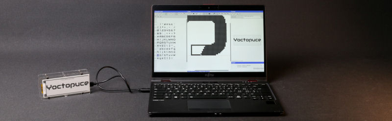

Yocto-FontEditor
==================================================


## An .yfm font files  editor for Yoctopuce displays 

This Yocto-FontEditor is a web based application meant to help you create
your own bitmap fonts for Yoctopuce displays. It allows to make fonts
scratch,  load/save .yfm[^1] file and import glyphs from True Type fonts[^2][^3] 
as well as BDF Fonts[^4] files. It even allows to constantly
preview your work on an actual Yocto-display[^3].


## How to use it ?
Just open the [Yocto-FontEditor.html file from the dist folder](dist/Yocto-FontEditor.html)
with a recent browser. The whole editor is contained in this html file, there is
no dependency, so you can copy it wherever you want. If you want to save
it on a YoctoHub copy the [.gz version](dist/Yocto-FontEditor.html.gz) on the hub file
system, access to it will be more efficient.

The user interface is supposed to be self explanatory, but if something isn't clear,
you will find the [user manual here](https://www.yoctopuce.com/EN/article/yocto-fonteditor-un-nouvel-editeur-de-fontes).
 
## How to modify/compile it ?
The application is written in Typescript, it requires a compilation pass to be usable.
The first time , this requires a bit of preparation: Make sure you have [node.js](https://nodejs.org/en) 
and [typecript](https://www.typescriptlang.org/)  installed on your computer, place yourself in the top folder and type:


``` 
npm install
```
This  will install the few dependencies your system needs to compile the application. 
Note: this system is based on a [Typescript application template](https://www.yoctopuce.com/EN/article/a-typescript-app-template-project)
provided by Yoctopuce.

Once everything is set,  simply start:
```   
npm run app-server
```

This will start a tiny web server process that will compile the application, launch 
it with your default browser, and then monitor the source files and recompile the application
every time a change is detected. In other words, after each modification, you
just have to make sure the compilation went fine and hit reload on your browser. 

## The Windows 7 case
If you are still developping with Windows 7, the latest version of Node.js you can use is 12 
and you will have to make a few adjustements to the 'package.json' file:
``` 
"@types/node": "^12.0.0",
"esbuild": "0.21.5",
"typescript": "5.0.4"
```

## Folder content

| file           | description                                    |
|:---------------|:-----------------------------------------------|
| app-server.ts  | TypeScript source file for the tiny web server | 
| tsconfig.json  | TypeScript compiler settings for this tool     | 
| README.md      | This file                                      |

## SubFolders 

| folder         | description                                     |
|:---------------|:-------------------------------------------------|
| artwork        | various artwork[^5]                              | 
| dist           | ready-to-use compiled files                      | 
| obj            | compiled modules                                 |
| src            | All sources files                                |


[^1]:In case you're wondering, the .yfm file format is described in the
[Yocto-Displays user manual](https://www.yoctopuce.com/EN/products/yocto-maxidisplay-c/doc/D128X64C.usermanual.html#CHAP3SEC6).
 
[^2]:Many fonts are copyrighted, having a font file installed on your
computer doesn't mean you are allowed to do whatever you want
with. In case of doubt, buy a proper license for the font you fancy, or import open
fonts distributed by sites like [openfont.org](https://openfont.org/).

[^3]:Some features require a [VirtualHub V2](https://www.yoctopuce.com/EN/virtualhub.php) 
to run on the computer running the application.

[^4][Glyph Bitmap Distribution Format (BDF)]((https://en.wikipedia.org/wiki/Glyph_Bitmap_Distribution_Format)) is a old bitmap font format.

[^5]:Artwork files are just reference files used for the design, they
are not used directly in the application. The actual graphics are
defined in the  [ressources.ts files](src/ressources.ts).